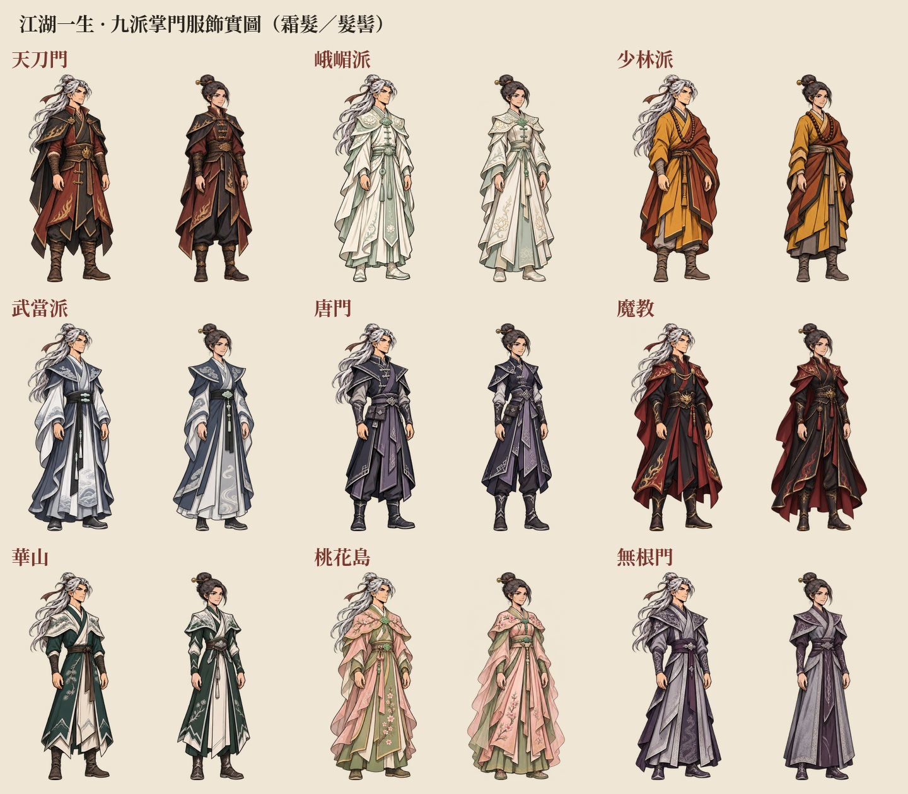
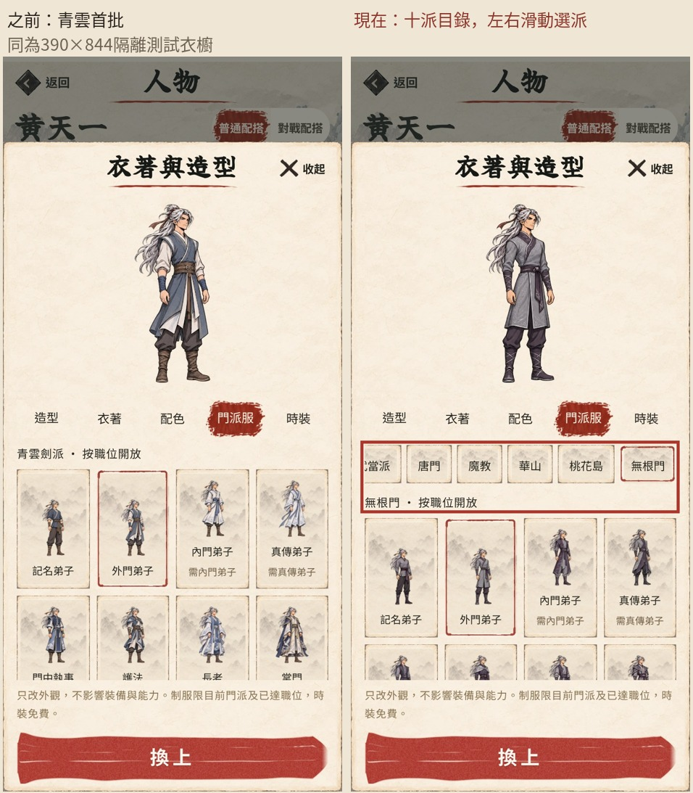
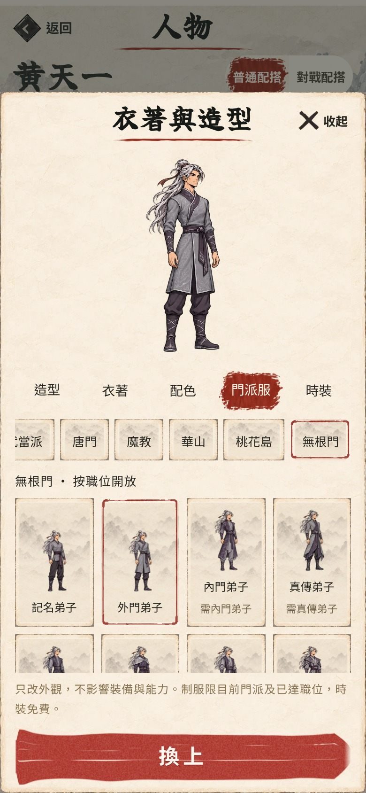
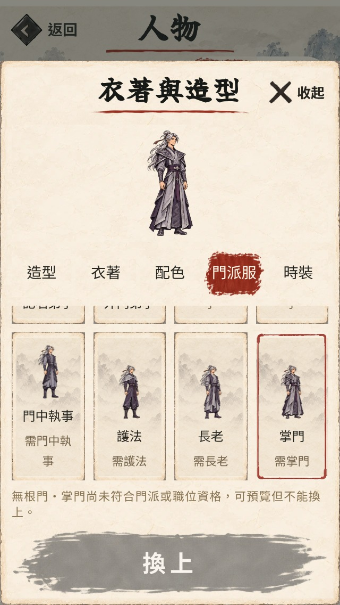

# 十派制服及九派新增立繪實畫

第65項，EA0.107.0。玩家要求完成其餘九派並保留原有入派條件。這輪新增九派各八職位、每套八造型，共576張完整立繪；連同已發布青雲及四時裝共672張。原96張圖及目錄記錄未改動。

## 素材及實畫

144張採用原圖集／576張新增完整人物，來源分格、真透明留白及邊界守門通過；四張原背景殘留來源被拒絕並重生成，舊原圖隔離於design/art/all-sect-uniforms/rejected，沒有放入正式目錄。九派男女共18份接觸表已逐份檢視，確認完整站姿、連續頭頸、雙手雙靴、八種面孔髮型及職位衣形差異。不是分頭身腳拼接，也沒有恢復細節人物戰鬥。

672張出貨圖全通過512×1024、alpha及有效全身邊界；672個頭像裁切有足夠人物像素，不是空白裁切。來源與輸出hash、分格、頭靴及頭像邊界記於正式目錄；素材報告見assets-qa.json、source-audit.json、visual-review.json。新576張WebP約44.55MiB，按需載入，沿用16外觀有界快取。

## 瀏覽器與存檔

Chromium隔離測試檔，封鎖Supabase；全部672款真正Canvas載入成功、畫面hash各異、完整身體不裁邊、沒有改動裝備／屬性／玉石／書頁。十派×320×568／390×844／430×932共30組衣櫥操作：目前門派名稱開窗可見，八職位可預覽，高階及跨派不能保存，取消不換衫，合資格確認保存並重開保留；最近時裝保持，模擬降職後顯示回退並於重開後保持，無pageerror。另驗無門派可預覽十派但不能穿著，修煉→門派十個拜師入口均存在。完整報告見browser.json。

初次整套測試在最後由全屏人物頁轉往修煉時，測試工具跳過「返回鎮居」而找不到導覽；已修工具流程、加中途記錄並重新跑完整672款及30組操作全部通過。不是玩家存檔或拜師入口失效。門派目錄初開時曾未將排後面的目前門派滾到可見位置，已修正並在十派三尺寸驗可見範圍。

純邏輯及真正保存指令另有測試：十派職位完整資格矩陣、跨派／越級／未知ID拒絕、離派／轉派回退、舊檔與新服飾往返、原入派根基／心性／桃花雅藝／無根奇緣保持，不改RNG／次數／能力。十派達原條件可按原收錄機率入派並獲本派入門武學；沒有改收錄機率或晉升。

完整138檔1,021項、Pages正式構建、敘事hard-fail 0、文案禁句0處及git diff檢查通過。沒有真iPhone、跨裝置或真人多人門派戰驗收；黑影戰鬥保持，沒有新TestFlight發布。一般授權下可發布，實際合併及線上確認以PR／Pages及正式站檢查為準。
