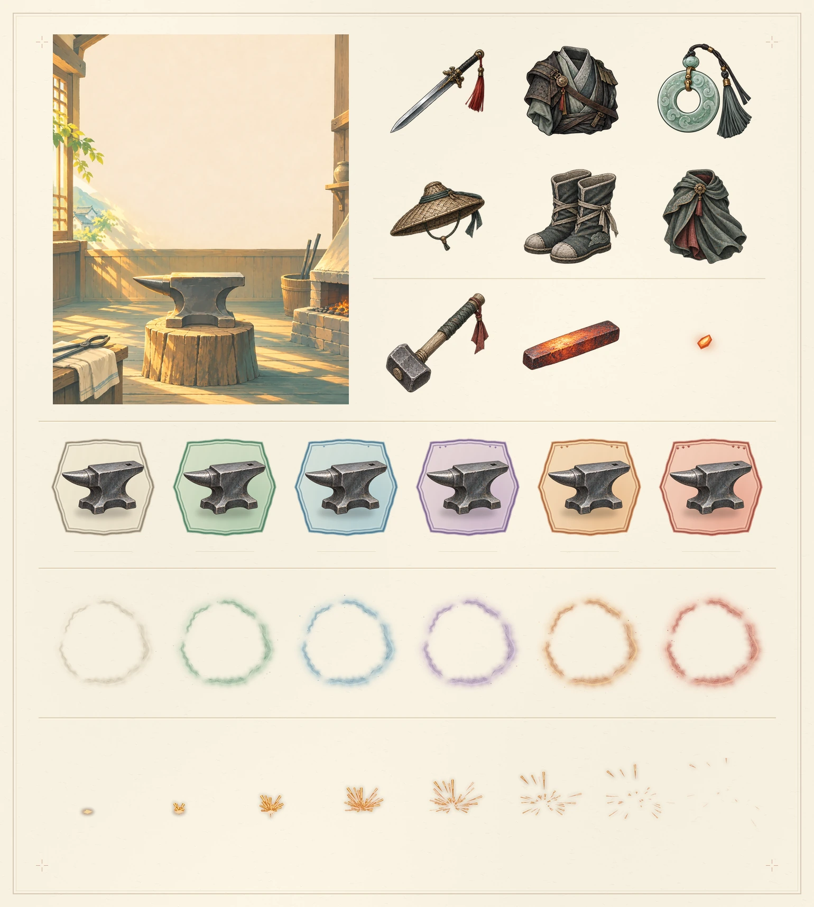

# 鍛造台與新裝備部位素材

對照板左上係鐵匠鋪。右上由上至下係舊裝備參考（劍、護甲、玉珮）、新裝備（斗笠、布靴、披風），再到鐵鎚、鐵胚同單粒火星。下半第一排係鍛造台，第二排係同色墨環，兩排都由左至右排凡、良、珍、絕、曠、神。最底由左至右係同一次敲擊嘅八格火花。

## 檔案同用途

| 檔案 | 尺寸（px） | 用途及提示詞 |
| --- | ---: | --- |
| `public/ink/art/person/gear-head.webp` | 256×256 | 頭飾欄 · A 左上，暖金竹篾斗笠、青綠帽帶 |
| `public/ink/art/person/gear-feet.webp` | 256×256 | 鞋具欄 · A 中上，青灰綁帶布靴 |
| `public/ink/art/person/gear-cloak.webp` | 256×256 | 披風欄 · A 右上，青綠旅人斗篷、暖金扣同低飽和朱砂內襯 |
| `public/ink/art/forge/table-common.webp` | 256×256 | 凡級鍛造台 · C，米白瓷邊、霧面稀疏反光 |
| `public/ink/art/forge/table-fine.webp` | 256×256 | 良級鍛造台 · C，青玉綠邊、柔和亮邊 |
| `public/ink/art/forge/table-rare.webp` | 256×256 | 珍級鍛造台 · C，淺瓷藍邊、一道清亮反邊 |
| `public/ink/art/forge/table-epic.webp` | 256×256 | 絕級鍛造台 · C，淺灰紫邊、多一層細緻光澤 |
| `public/ink/art/forge/table-mythic.webp` | 256×256 | 曠級鍛造台 · C，琥珀橙邊、暖金反光 |
| `public/ink/art/forge/table-divine.webp` | 256×256 | 神級鍛造台 · C，朱砂紅邊、暖白紅金反光 |
| `public/ink/art/forge/scene.webp` | 1080×1350 | 場景底圖 · B，不透明，上半部留數值面板區 |
| `public/ink/art/forge/hammer.webp` | 512×512 | 獨立敲擊圖層 · A 中下，鎚頭左下、握把右上 |
| `public/ink/art/forge/blank-ingot.webp` | 512×256 | 鐵砧上嘅燒紅鐵胚 · A 右下，暗紅氧化皮配橙白熱邊 |
| `public/ink/art/forge/sparks-sheet.webp` | 2048×256 | 敲擊火花八格圖集 · E，橫排左至右，每格 256×256 |
| `public/ink/art/forge/burst-common.webp` | 768×768 | 凡級升級墨環 · D，白玉紙色，淡墨暈 |
| `public/ink/art/forge/burst-fine.webp` | 768×768 | 良級升級墨環 · D，青綠，柔青玉亮邊 |
| `public/ink/art/forge/burst-rare.webp` | 768×768 | 珍級升級墨環 · D，瓷藍，清亮半乾筆 |
| `public/ink/art/forge/burst-epic.webp` | 768×768 | 絕級升級墨環 · D，淺灰紫，淡紫纖維光邊 |
| `public/ink/art/forge/burst-mythic.webp` | 768×768 | 曠級升級墨環 · D，琥珀橙，暖金飛墨 |
| `public/ink/art/forge/burst-divine.webp` | 768×768 | 神級升級墨環 · D，朱砂紅，紅金收邊同較密飛墨 |
| `public/ink/art/forge/ember.webp` | 128×128 | 可重複噴發嘅單粒火星 · F |
| `production/qa/evidence/redesign/forge-art/board.webp` | 1540×1716 | 宣紙對照板 · G，不透明 |

除場景同對照板外，全部用透明底。火花每格嘅共同落點係 (128, 169)，座標由各格左上角計。場景鐵砧工作面中心約喺 (540, 883)，座標由場景左上角計。八格畫同一批火星由敲擊點散開、下墜同熄滅。

## 生成提示詞

### A · 裝備與獨立器物母圖

用現行劍、護甲同玉珮圖示做參考。斗笠、布靴、披風、鐵砧、鐵鎚同鐵胚由同一幅六格底稿拆出。

> Create a premium bitmap game item sprite atlas on TRUE TRANSPARENT alpha; layout exactly 3 columns by 2 rows, landscape aspect 3:2, six equal square cells, generous clear gutters. No graphics cross any cell, no cast shadow, text, symbols or frames. Match the THREE attached original game icons very closely: slightly aged, fine variegated ink contours, skillfully rendered material detail and compact three-quarter inventory composition, desaturated celadon and muted warm-gold fasteners with occasional deep brick-red. Keep contrast and clean edges that read on bright ivory paper. Upper-left: woven bamboo Chinese wuxia travel douli hat in three-quarter view, desaturated honey straw and dark teal braided hat band and a tucked short chin cord, object only; upper-center: a pair of charcoal-teal fabric kung-fu boots, cloth bindings and small oatmeal stitched panels; upper-right: a single folded-and-draped dark celadon travel cloak with aged bronze clasp, muted red lining and sweeping lower folds, empty neckline, no person. Lower-left: a single neutral gray blue steel blacksmith anvil, recognizable side-on three-quarter silhouette with horn on the LEFT, flared squared feet, bright forged facets, very subtle tool scratches, no base pedestal or frame or colored halo. Lower-center: a single old square iron smithing hammer, clearly the iron hammer HEAD at LOWER LEFT (striking-face oriented downward and left), handle pointing diagonally to UPPER RIGHT, pale aged wood and fabric-wrapped grip, bold silhouette. Lower-right: a single red-hot nearly horizontal forged blank, elongated flat rectangular cuboid with softened corners in slight oblique view, white-orange upper edge, rust-black scale speckles and warm dark-red flank, no fire around it. All six items clearly isolated. Authentic original Chinese wuxia prop concept art, painterly Chinese manhua material rendering, no letters or watermarks.

### B · 鐵匠鋪

用現行千燈鎮晨景做光影同筆觸參考。

> Original 4:5 portrait game background illustration for Chinese wuxia life simulation. Use attached approved illustration as strict reference for painterly Chinese manhua line weight, large flat/light planes, muted turquoise shadows, golden sunlight and paper-ivory brightness; create entirely new subject and composition. Interior of a humble small town historic Chinese blacksmith shop, bright inviting morning, stained pine wood and pale limewashed plaster. Strong compositional contract: upper 48% is calm, luminous warm cream plaster with very subtle paper fibers and almost no details, suitable for overlay of numeric UI across the width. Limit beams/window to far side edges and keep their contrast soft above the midpoint. Mid-lower central hero: one clearly readable small charcoal-gray iron anvil, horn points LEFT, placed on a stump; flat top and impact point near x=50%, y=65% of the full image. Its working face must be empty and free for separately animated hammer and ingot, leave clear space around the anvil. Lower sides may have a small banked brick hearth lower right with a few amber coals, and folded cloth and tongs lower left; no large clutter or competing focal point. Left side warm slant daylight illuminates horizontal wooden floor, dusty celadon and pale jade shadows, warm golden rim on objects, sharp purposeful varied ink and gouache-like cel shading. No people, no signs, no glyphs, no embedded UI, no letters, no logos, no night, no glow effects. Full bleed opaque painting.

### C · 鍛造台框邊（點陣繪製）

> 用 A 左下嘅鐵砧當共同底圖。六級用同一比例同座標、同一磨邊八角牌同淡宣紙色牌面。沿凡白、良綠、珍藍、絕淺紫、曠橙、神朱砂紅調整窄框釉色同受光邊，逐級加深反光同框面刻紋。鐵砧保持鋼灰，頂左受光同底部接觸陰影一致。框外透明，無字。

### D · 六級升品墨環（點陣繪製）

> 畫居中嘅半乾墨圈，用不規則粗幼、斷續刷毛、少量飛墨同淡暈染。中心及四邊留透明，可以疊喺裝備外面。沿凡白、良綠、珍藍、絕淺灰紫、曠琥珀橙、神朱砂紅提升墨暈厚度、亮邊同飛墨密度。用淡色纖維亮邊，避免螢光色同放射星芒。無字。

### E · 敲擊火花（點陣繪製）

> 喺同一個敲擊點畫暖金白火芯同橙紅鐵屑。用短斜筆觸沿粒子飛行方向拖尾，第一格集中，第二至四格向上同兩側散開，之後受重力下墜並熄滅。八格用同一敲擊點同同一組運動軌跡，各格四邊透明，無字。

### F · 單粒火星（點陣繪製）

> 一粒向右上斜嘅不規則熾紅鐵屑，朱砂外緣、橙紅斷面、暖白細芯，貼住粒子嘅一小圈低透明暖暈。居中、四邊透明，無字。

### G · 宣紙對照板（點陣排版）

> 用明亮暖米白宣紙、淡纖維同細窄磨邊。左上放直幅場景，右上分舊裝備、新裝備、敲擊物件三排。下半將六張鍛造台同六圈同色墨環逐列對齊，最底由左至右排八格火花。素材直接取自交付檔案，圖內留白同分隔用淡金墨線處理，無字。
