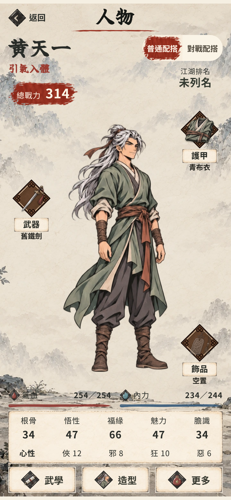
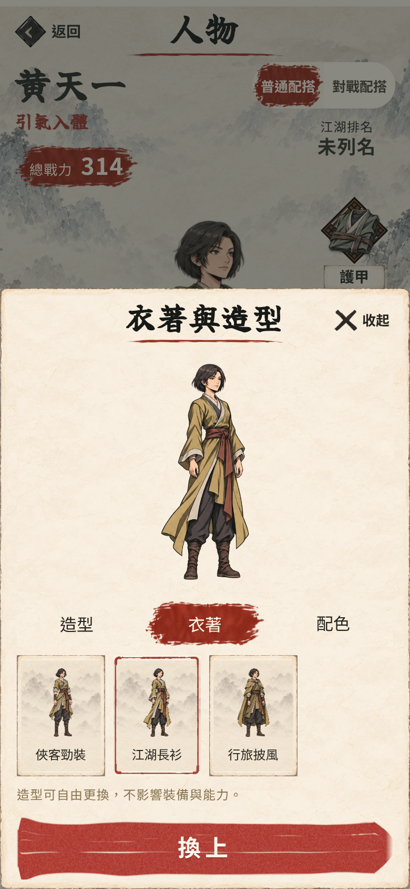
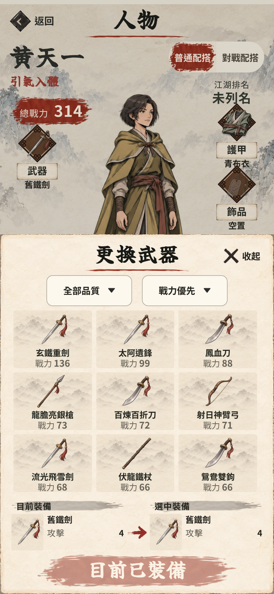

# 武俠漫畫人物與器物實畫

第63項，EA0.105.0。玩家接受漫畫小樣後要求生成其他裝備、衣服並套用人物換衫畫面。

24張完整人物圖及14款器物通過尺寸／alpha檢查；透明接觸表見 `contact.png`。來源、hash、規格及重建說明見 `design/art/manhua/README.md`。不把7類兵器共用圖誤稱為63件獨立圖。

Chromium隔離存檔，封鎖Supabase，8造型×3衣服×4色共96個實際Canvas切換，檢查全身邊界、畫面hash、裝備保持及pageerror。另檢查320×568、430×932畫面；沒有真正iPhone或新TestFlight驗收。原有黑影不變，沒有製作人物動畫或重設存檔。完整瀏覽器結果見 `browser.json`；素材報告見 `figures-qa.json`、`icons-qa.json`。

衣櫥換外觀、裝備欄換裝備的現有規則保留；新圖載入失敗會使用同身份舊圖後備。首輪測試發現並修正了頭像裁切偏移與配色斑駁；原生成稿不能代表最終畫面，以上以App截圖為準。

完整135檔1,001項測試、Pages構建、敘事hard-fail 0及文案禁句0處通過。`checkManhuaActions.py`另驗真換兵器只改普通配搭、衣櫥確認前不保存、確認後重開保留外觀及裝備、故障時使用同身份後備，結果見 `actions.json`。沒有為了介面改動戰鬥數值或獎勵。
