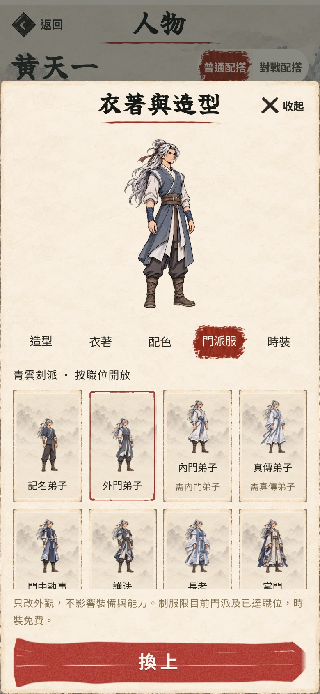
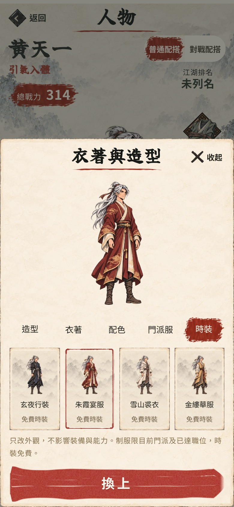
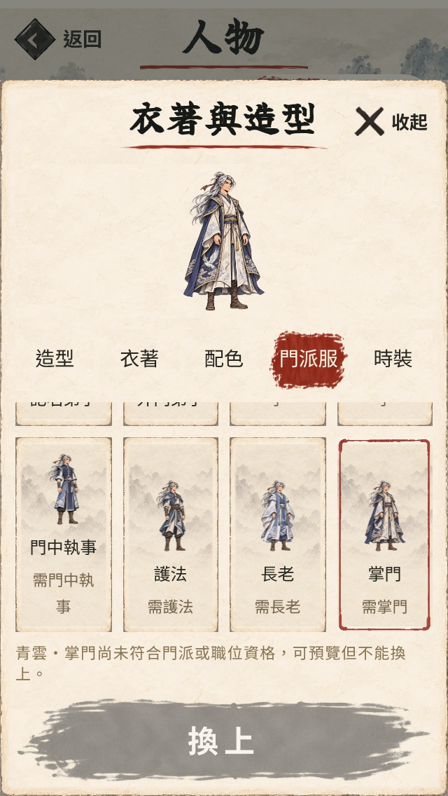

# 青雲制服與免費時裝實畫

第64項，EA0.106.0。只完成首批青雲八職位及四款時裝，保留八造型；未宣稱十派均完成。

96張完整圖通過512×1024與透明通道檢查，八份接觸表已檢視；原圖、來源hash及重建說明見design/art/qingyun-fashion/README.md。

Chromium隔離存檔，封鎖Supabase，檢查96個實際Canvas外觀：畫面hash各異、全身邊界未裁切、未改裝備／屬性／玉石／書頁。320×568、390×844、430×932再驗：高階制服只預覽不保存、低階制服可確認、時裝取消不保存、最近時裝保留、重開保留制服、模擬離派後顯示回退並於重開後保持、偽造制服指令被拒絕，沒有pageerror。完整結果見browser.json。

衣櫥保存及lifeGameStateSchema來回驗證在tests/wardrobe.test.ts；原常服及外觀ID保持。黑影戰鬥、機率、裝備數值、獎勵及門派地位不變；沒有真iPhone、所有故事離派事件或跨裝置驗收結論。

完整137檔1,008項、Pages構建、敘事hard-fail 0、文案禁句0處通過。開發時熱更新會改變實際store模組URL，測試工具改由畫面import取得同一個store，再跑完整96外觀與三尺寸驗證；這是測試工具的模組對位，不是正式遊戲的進度重設。
