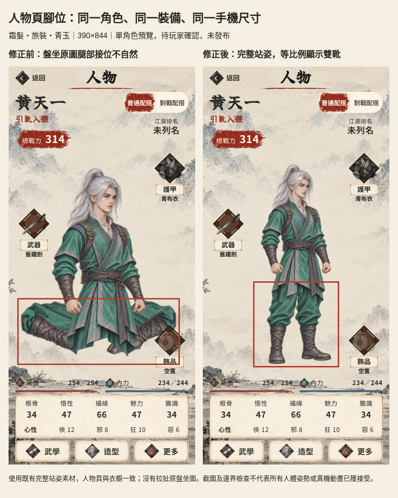

# 人物腳位：單角色站姿預覽

2026-11-14。**玩家看過前後圖後明確回覆「上線」，確認站姿修正；發布版本 EA0.104.1，實際合併及部署以 PR #163／Pages 紀錄為準。**

玩家指出人物頁盤坐截圖的腳位有誤，並同意先用完整自然站姿、交一角實際手機圖確認再擴展。本輪使用霜髮／旅裝／青玉同一存檔；沒有製作新人體或動畫。

## 改動及畫面

人物頁從原 `seated` 改讀同身份既有 `idle` 完整立繪，與衣櫥預覽一致；保留現有等比例繪畫和四邊留白，沒有拉扯盤坐圖或改人物身份。相關樣式改用 figure 名稱。原盤坐素材保留，但不再由人物頁讀取；戰鬥黑影、裝備及存檔格式不變。



- [修正前，390×844](before-person-390.png)
- [修正後，390×844](after-person-390.png)
- [修正後，320×568](after-person-320.png)
- [修正後，430×932](after-person-430.png)
- [同造型衣櫥](after-wardrobe-390.png)

## 實際檢查

Chromium，觸控模擬，DPR 2；隔離測試存檔，Supabase 請求封鎖。三個手機尺寸均檢查人物全身 Canvas 四邊像素，頭頂及雙靴沒有被裁走；取消裝備／造型預覽前後資料一致，沒有 pageerror。數據見 [after.json](after.json)。這是技術邊界驗證，不能當成玩家接受人體。

首頁正常動態另抽取六個連續樣本，人工檢視行走／揮擊；保存[行走幀](home-motion-00.png)及[揮擊幀](home-motion-03.png)。暫未見盤坐圖同款腿部錯接，黑影程式及素材未更改。這組抽樣不足以證明所有武學、受擊、倒地或所有移動均沒有滑步／穿地，也沒有真機 FPS 結論。

相關檢查：完整134檔998項 Vitest 通過；`npm run build` 通過；`npm run audit:narrate` hard-fail 0；`git diff --check` 通過。既有 build chunk 體積提示仍存在，與這次腳位預覽無關。

EA0.104.1發布前再次執行完整134檔998項測試、`npm run build:pages`、敘事及文案檢查，全部通過（hard-fail 0、禁句0處）；同一角色三個手機尺寸複驗均無裁切、取消預覽未改裝備及造型，沒有pageerror。這次複驗保存在本機 `.local-online/standing-release/`，原先評閱畫面不覆寫。

## 重現

開 Vite 後執行：

```bash
npm run dev -- --host 127.0.0.1 --port 5300
STANDING_BASE=http://127.0.0.1:5300/ python3 scripts/qa/checkStandingPortrait.py after
```

腳本沿用既有本機 fixture `.local-online/unify-game/fixtures.json`（不含真人雲端資料）；缺少該檔時要先按第61項驗證流程建立 fixture。`before` 模式用於原版本擷取，不能將改後的圖當成修正前。可直接在本機HTTP開 `compare.html` 檢視保存的前後原圖。

這一角的站姿修正已獲玩家確認及發布授權，沿用同造型既有完整站姿；未擴製新人體或盤坐素材。上面前後圖保留原先評閱時的標籤，不能把舊「待確認」標籤當成最新發布狀態。沒有新TestFlight或真iPhone驗收。
